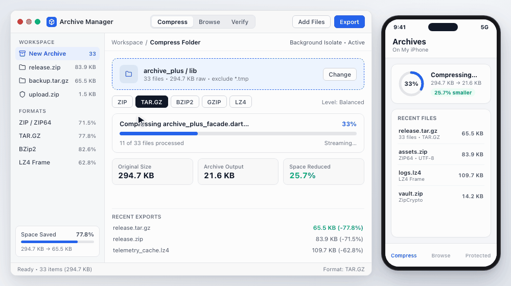

<p align="center">
  <a href="https://github.com/andikpbw/archive-plus">
    
  </a>
</p>

<h1 align="center">archive_plus</h1>

<p align="center">
  <strong>Modern, lightweight, zero-dependency archive &amp; compression engine for Dart &amp; Flutter.</strong><br/>
  Built from the ground up as a cleaner, safer, and customizable evolution of <code>package:archive</code>.
</p>

<p align="center">
  <a href="https://pub.dev/packages/archive_plus"></a>
  <a href="https://pub.dev/packages/archive_plus/score"></a>
  
  
  <a href="https://humanize.id"></a>
  <a href="https://github.com/andikpbw/archive-plus/blob/main/LICENSE"></a>
</p>

---

## Live UI Studio Preview

See **`archive_plus`** running live — compressing 33 files with real-time `ArchiveProgress` telemetry, inspecting ZIP Central Directory entries with **zero decompression**, extracting single entries selectively, and neutralizing **Zip-Slip** & **Zip-Bomb** attacks via `ArchiveSecurityPolicy`:

<p align="center">
  
</p>

---

## Why `archive_plus`?

`archive_plus` re-imagines archiving and compression for modern Dart 3 and Flutter apps — eliminating transitive dependency bloat while adding production-grade security guards, fluent ergonomics, and full WebAssembly support:

| Capability | `archive_plus` | Legacy `archive` |
| --- | :---: | :---: |
| **Zero runtime dependencies** (`dependencies:` empty) | ✅ | ❌ (`path`, `posix`) |
| **All 6 Platforms + WebAssembly (`dart2wasm`) ready** | ✅ | ⚠️ Partial |
| **Fluent `ArchiveBuilder` + One-liner `ArchivePlus` facade** | ✅ | ❌ |
| **ZIP (Store, DEFLATE, BZip2, ZIP64, UTF-8, ZipCrypto)** | ✅ | ✅ |
| **Zero-decompression `inspectZip()` & selective `extractZipEntry()`** | ✅ | ❌ |
| **TAR (USTAR, PAX Extended Headers, GNU LongName) + `.tar.gz` / `.tar.bz2`** | ✅ | ✅ |
| **Pure Dart DEFLATE, ZLIB, GZIP (multi-member), BZip2 & LZ4 Frame** | ✅ (inc. LZ4!) | ❌ (no LZ4) |
| **Built-in `ArchiveSecurityPolicy` (Zip-Slip, Zip-Bomb ratio, Symlinks)** | ✅ Unified | ⚠️ Split flags |
| **Exhaustive Dart 3 `sealed class ArchiveException`** | ✅ | ❌ |
| **Real-time `ArchiveProgress` & cooperative `ArchiveCancelToken`** | ✅ Built-in | ❌ Manual |
| **Built-in `ArchiveIsolate` background workers (jank-free Flutter UI)** | ✅ Built-in | ❌ Manual |
| **Declarative glob `ArchiveFilter`, `Archive.diff`, & `ArchiveCodecRegistry`** | ✅ Built-in | ❌ |

---

## Supported Formats

| Format | Encode | Decode | Standards & Highlights |
| --- | :---: | :---: | --- |
| **ZIP** | ✅ | ✅ | PKWARE APPNOTE 6.3, Store/DEFLATE/BZip2, ZIP64, UTF-8 EFS, Extended UTC Timestamps (`0x5455`), ZipCrypto encryption, O(1) Central Directory inspection |
| **TAR** | ✅ | ✅ | POSIX USTAR, automatic PAX Extended Headers (`x`/`g`) for >100-byte & Unicode paths, GNU LongName (`L`/`K`) |
| **TAR.GZ / TGZ** | ✅ | ✅ | One-liner `tarGz()` / `untarGz()` & automatic inner-TAR detection in `decodeAuto()` |
| **TAR.BZ2 / TBZ2** | ✅ | ✅ | High-ratio BZip2-compressed TAR containers |
| **GZIP** | ✅ | ✅ | RFC 1952 with `FNAME`, `FCOMMENT`, `FEXTRA`, `FHCRC`, multi-member streams & `dart:convert` `Codec` |
| **ZLIB** | ✅ | ✅ | RFC 1950 with strict header check bits, Adler-32 validation & `dart:convert` `Codec` |
| **DEFLATE** | ✅ | ✅ | Pure Dart RFC 1951 (Stored, Fixed Huffman, optimal Package-Merge length-limited Dynamic Huffman) |
| **BZip2** | ✅ | ✅ | Pure Dart O(n log n) BWT + multi-table Huffman encoder & decoder + multi-stream support |
| **LZ4 Frame** | ✅ | ✅ | Official LZ4 Frame Format (v1.6) with XXH32 header/block/content checksums & skippable frames |

---

## Installation

Add `archive_plus` to your `pubspec.yaml`:

```yaml
dependencies:
  archive_plus: ^1.0.0
```

Import the **Web & Wasm-safe core library** anywhere:

```dart
import 'package:archive_plus/archive_plus.dart';
```

Or import the **platform-adaptive I/O + Isolate library** (uses conditional exports so it still compiles cleanly on Web and Wasm!):

```dart
import 'package:archive_plus/archive_plus_io.dart';
```

---

## Quick Start

### 1. Fluent Archive Building & Progress Telemetry

```dart
import 'package:archive_plus/archive_plus.dart';

void main() {
  final cancelToken = ArchiveCancelToken();

  final zipBytes = ArchivePlus.builder()
      .addText('README.md', '# Hello ArchivePlus')
      .addJson('config/settings.json', {'theme': 'dark', 'v': 1}, pretty: true)
      .addBytes('assets/icon.bin', [0x89, 0x50, 0x4E, 0x47])
      .addDirectory('empty_folder/')
      .withComment('Packaged with ArchivePlus')
      .encodeZip(
        options: ZipEncodeOptions(
          level: CompressionLevel.best,
          autoStoreIfLarger: true, // Never bloat already-compressed files!
          password: 'optional-secret-password',
          cancelToken: cancelToken,
          onProgress: (p) {
            print('${p.phase.name}: ${(p.fraction * 100).toStringAsFixed(0)}%');
          },
        ),
      );
}
```

### 2. Zero-Decompression ZIP Inspection & Selective Extraction

Inspect massive ZIP archives in microseconds without inflating a single byte, then extract only the exact entry you need:

```dart
// Reads only the Central Directory — 0 bytes decompressed!
final summary = ArchivePlus.inspectZip(zipBytes);
print('Files: ${summary.fileCount}, saved ${summary.savedPercentage.toStringAsFixed(1)}%');

for (final entry in summary.entries) {
  print('${entry.name} (${entry.uncompressedSize} B -> ${entry.compressedSize} B)');
}

// Inflate ONLY one entry without touching the rest of the archive:
final config = ArchivePlus.extractZipEntry(zipBytes, 'config/settings.json');
print(config?.readAsJson());
```

### 3. Built-In Security Policy & Exhaustive Sealed Exceptions

Protect your Flutter or backend app from **Zip-Slip** (`../../etc/passwd`), **Zip-Bomb** memory exhaustion, symlink escapes, and corrupted checksums out of the box:

```dart
try {
  final archive = ArchivePlus.unzip(
    untrustedBytes,
    options: const ZipDecodeOptions(
      securityPolicy: ArchiveSecurityPolicy.strict,
    ),
  );
  print('Safely extracted ${archive.length} entries');
} on ArchiveException catch (error) {
  switch (error) {
    case ArchiveSecurityException(:final violation):
      print('Blocked malicious archive: $violation');
    case ArchivePasswordException():
      print('Missing or incorrect ZIP password');
    case ArchiveChecksumException(:final expected, :final actual):
      print('Corrupted payload (expected $expected, got $actual)');
    case ArchiveFormatException(:final message):
      print('Invalid archive format: $message');
    case ArchiveCancelledException():
      print('Operation cancelled by user');
    case ArchiveIoException(:final message):
      print('File system error: $message');
  }
}
```

### 4. Auto-Detection, TAR / TAR.GZ / TAR.BZ2 & Single-Stream Codecs

```dart
// Auto-detect ZIP, TAR, TAR.GZ, TAR.BZ2, GZIP, ZLIB, BZip2, or LZ4:
final format = ArchivePlus.detectFormat(bytes);
final decoded = ArchivePlus.decodeAuto(bytes);

// One-liner stream compression:
final gz = ArchivePlus.gzip(rawBytes, options: const GZipOptions(filename: 'log.txt'));
final restoredGz = ArchivePlus.gunzip(gz);

final bz2 = ArchivePlus.bzip2(rawBytes);
final restoredBz2 = ArchivePlus.bunzip2(bz2);

final lz4 = ArchivePlus.lz4(rawBytes);
final restoredLz4 = ArchivePlus.unlz4(lz4);

// Standard dart:convert streaming:
final compressedStream = inputStream.transform(const GZipPlusCodec().encoder);
```

### 5. Declarative Filtering, Archive Diffing & Custom Codecs

```dart
// Filter entries with glob patterns, extensions, or size limits:
final dartOnly = ArchivePlus.unzip(
  zipBytes,
  options: const ZipDecodeOptions(
    filter: ArchiveFilter(
      includeGlobs: ['lib/**/*.dart'],
      excludeGlobs: ['**/*.g.dart'],
      maxUncompressedSize: 5 * 1024 * 1024,
    ),
  ),
);

// Diff two archive snapshots:
final diff = previousArchive.diff(currentArchive);
print('Added: ${diff.added.length}, Modified: ${diff.modified.length}');

// Extend with your own custom compression or container codec:
final registry = ArchivePlus.defaultRegistry();
registry.registerCompression(MyCustomCodec());
```

### 6. Native File System & Jank-Free Background Isolates

```dart
import 'package:archive_plus/archive_plus_io.dart';

// Compress a directory to ZIP or TAR.GZ with glob filtering:
await ArchiveFileSystem.compressDirectoryToZip(
  '/path/to/project',
  '/path/to/release.zip',
  directoryFilter: const ArchiveFilter(excludeGlobs: ['build/**', '*.tmp']),
);

// Extract safely to disk (canonical root containment enforced):
await ArchiveFileSystem.extractAutoFile('/path/to/release.zip', '/path/to/output');

// Run heavy compression off the Flutter UI thread via Isolate.run:
final zipBytes = await ArchiveIsolate.encodeZip(largeArchive);
final unpacked = await ArchiveIsolate.decodeZip(zipBytes);
```

---

## Real Measured Benchmarks

Measured in pure Dart 3 JIT on `archive_plus`'s own 33-file source bundle (**294.7 KB** uncompressed):

| Format | Output Size | Space Saved | Encode Time | Decode Time |
| --- | ---: | ---: | ---: | ---: |
| **BZIP2** | 51.4 KB | **82.6%** | 107.8 ms | 19.9 ms |
| **TAR.BZ2** | 52.3 KB | **82.3%** | 128.8 ms | 30.6 ms |
| **TAR.GZ** | 65.5 KB | **77.8%** | 27.5 ms | 6.9 ms |
| **ZLIB** | 67.3 KB | **77.1%** | 28.6 ms | 3.7 ms |
| **GZIP** | 67.4 KB | **77.1%** | 22.5 ms | 3.4 ms |
| **ZIP** | 83.9 KB | **71.5%** | 22.8 ms | 10.9 ms |
| **LZ4 Frame** | 109.7 KB | **62.8%** | 49.6 ms | 10.1 ms |

---

## Support & Sponsorship

This open-source library is proudly supported by **[Humanize AI](https://humanize.id)** — helping build high-craft developer tools and AI solutions from Indonesia for the global Dart & Flutter ecosystem.

If `archive_plus` saves you time or strengthens your app's security, consider starring the repository on [GitHub](https://github.com/andikpbw/archive-plus) and visiting **[Humanize AI](https://humanize.id)**.

---

## Contributing & Issues

Contributions, benchmarks, and bug reports are welcome at [https://github.com/andikpbw/archive-plus](https://github.com/andikpbw/archive-plus).

## License

Released under the [MIT License](https://github.com/andikpbw/archive-plus/blob/main/LICENSE) — Copyright © 2026 Humanize AI Indonesia.
